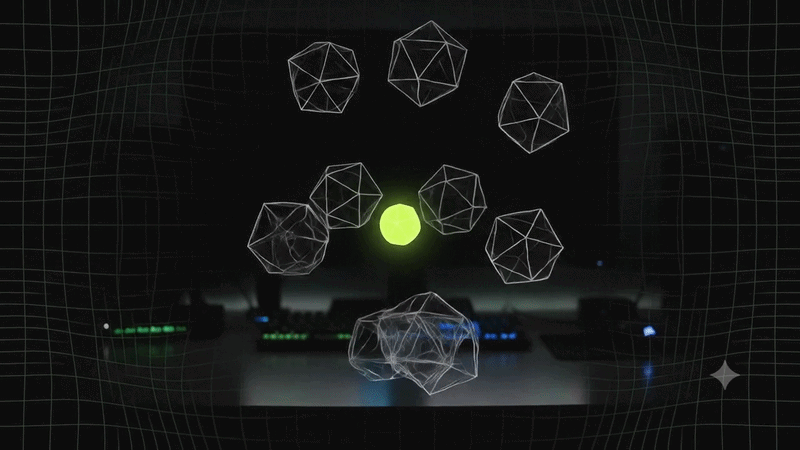
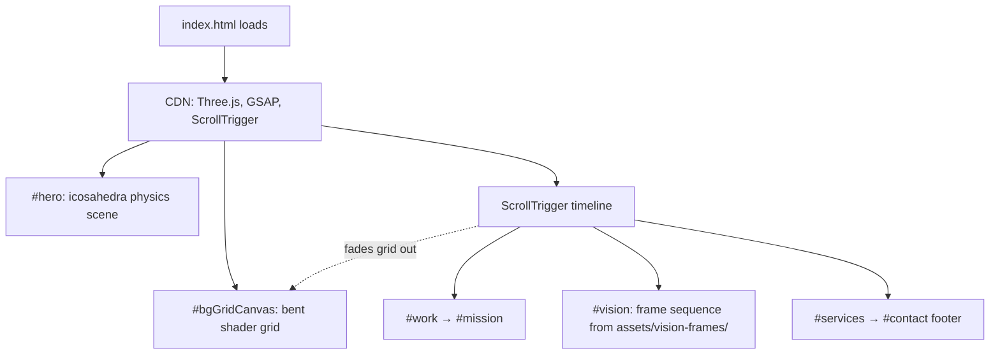

# Vessel

A single-page landing site concept for a fictional immersive-worlds studio, built as one self-contained `index.html` with Three.js, GSAP ScrollTrigger and WebGL shaders. For designers and front-end developers who want an interactive, motion-heavy portfolio template.

**Live demo:** [vessel-five-alpha.vercel.app](https://vessel-five-alpha.vercel.app/)




## Features

- **Physics hero.** 58 wireframe icosahedra drift and bounce inside a curved play area. Click and drag to grab one and throw it; wall hits spawn color splashes.
- **Bent WebGL grid background.** A procedural diamond grid drawn in a fragment shader on a plane bent in the vertex shader, with mouse parallax, scroll travel, color grading and ripples.
- **Scroll-scrubbed Vision section.** 96 pre-rendered frames drawn to a canvas as you scroll through a pinned section, behind a "liquid glass" panel.
- **Custom cursor.** Dot + trailing ring that labels itself over links, magnetic buttons, and hover previews on the work list.
- **Tilting service cards** and a footer reveal effect.
- **Accessible motion fallbacks.** Parallax is skipped under `prefers-reduced-motion` and on touch pointers.

## How it works

Everything is in `index.html`: inline CSS, inline scripts, and three CDN scripts (Three.js r128, GSAP 3.12.5, ScrollTrigger). Fonts come from Google Fonts. There is no build step and no package manager.



Page order: hero → selected work → mission → vision → services → footer.

## Quickstart

Open `index.html` directly in a browser, or serve the folder (recommended, so the frame images load the same way as on the live site):

```bash
git clone https://github.com/0jz/Vessel.git
cd Vessel
npx serve .
```

`python -m http.server` works too. An internet connection is needed for the CDN scripts and fonts.

## Configuration

No environment variables. Things you are expected to edit live in `index.html`:

| What | Where |
|---|---|
| Studio name, copy, work items (Northlight, Fathom, Aurelia, Driftwave) | HTML sections `#hero`, `#work`, `#mission`, `#services` |
| Nav and footer links (currently `href="#"`) | `<nav>` and `<footer id="contact">` |
| Number of hero shapes | `const COUNT = 58` in the hero script |
| Vision frames | `assets/vision-frames/frame_00.png` … `frame_95.png` (`FRAME_COUNT = 96`) |

## Deploy

Any static host works. The live demo is on Vercel with no build command: Vercel serves `index.html` from the repo root, so keep that filename.

## Project structure

```
Vessel/
├── index.html                  # The whole site: markup, CSS, WebGL and scroll scripts
├── assets/vision-frames/       # 96 PNG frames for the scroll-scrubbed Vision section (~12 MB)
└── vessel-studio-notes_2.md    # Design and implementation notes, change log, todo list
```

## Status & limitations

- **Concept / template.** The studio name, copy and work items are placeholder content, not a real studio.
- Contact and nav links are placeholders.
- Performance on low-end and mobile devices has not been profiled (58 physics objects, two WebGL canvases, 96 frame images).
- Desktop-first: drag-to-throw and cursor effects need a mouse.
- `vessel-studio-notes_2.md` is a working log; some early sections describe approaches that were later replaced (for example the SVG grid and the video slot).

## License

No license file yet. All rights reserved by the author until one is added.
